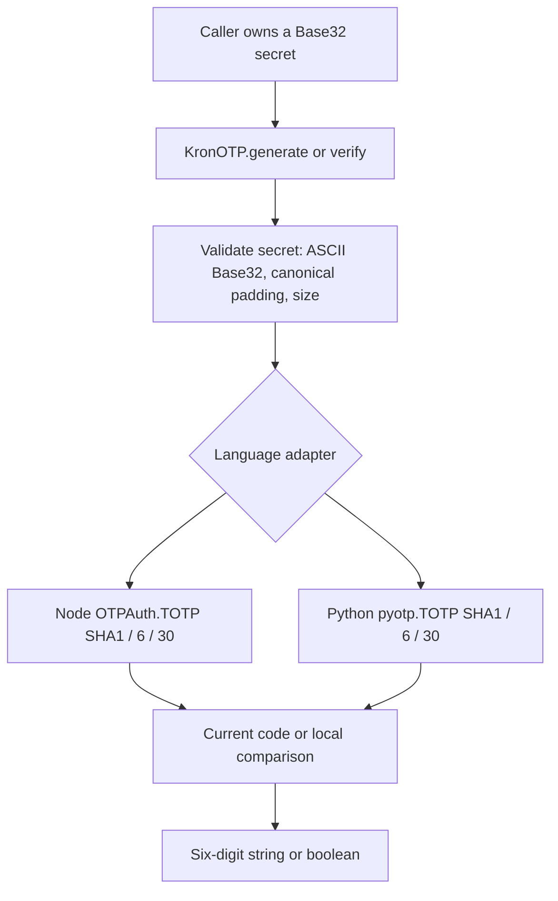
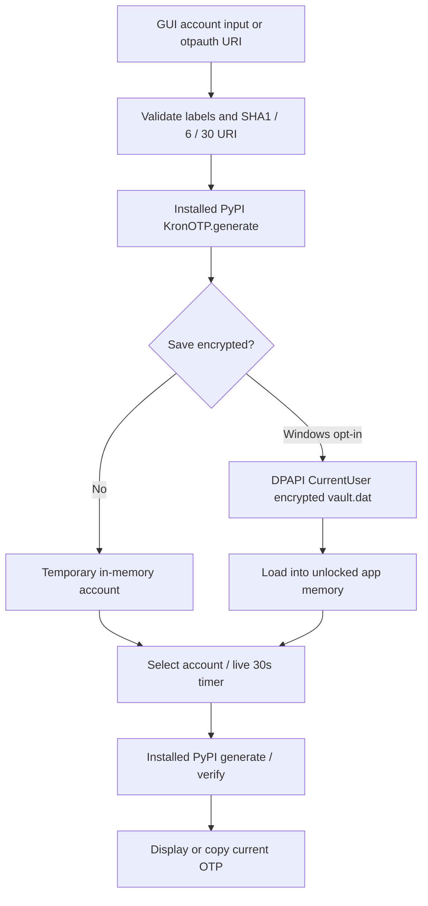

## Distribution and source boundaries

| Artifact | Runtime entry | Implementation | External runtime dependency |
| --- | --- | --- | --- |
| npm `kron-otp@2.0.0` | `require('kron-otp')` | `javascript/src/kron-otp.js` | `otpauth ^9.6.0` |
| PyPI `kron-otp==2.0.0` | `from kron_otp import KronOTP` | `python/src/kron_otp.py` | `pyotp>=2.12,<3` |
| Optional Tkinter desktop app | `python python/tests/gui/app.py` | `python/tests/gui/app.py` | **Installed PyPI 2.0.0** + Python standard library |
| Windows encrypted app vault | imported by GUI, not by library | `python/tests/gui/vault.py` | Windows CurrentUser **DPAPI**, called via `ctypes` |

The package libraries themselves are stateless, synchronous, in-process adapters. No HTTP API, CLI, database, background worker, environment-based engine settings, web service, event emitter, hooks or database transactions are implemented.

## Public TOTP execution

**JavaScript internal path:** `KronOTP.#createTOTP(secret)` enforces type and size, strips ASCII whitespace, checks canonical Base32 and decoded byte length, calls `OTPAuth.Secret.fromBase32`, and constructs an `OTPAuth.TOTP` with fixed `algorithm: 'SHA1'`, `digits: 6`, `period: 30`. `generate` delegates to `.generate()`; `verify` validates the token as a six-digit string then delegates to `.validate({ token, window: 1 })` and returns a boolean. The private `#createTOTP` is **not exported**.

**Python internal path:** `_normalize_secret` validates case/ASCII whitespace, canonical padding and ≥14 decoded bytes; `_totp` constructs `pyotp.TOTP` with `hashlib.sha1`, six digits and `interval=30`. `generate` calls `.now()`. `verify` requires exactly six ASCII digits and samples the clock once. During Unix times 0–29 seconds it avoids testing counter −1; otherwise it delegates to PyOTP `valid_window=1`. Leading zeros are preserved.

Validation failures: JavaScript `generate` raises `TypeError`; Python `generate` raises `ValueError`. For normal invalid input both `verify` methods return boolean false. No public constructor parameters, timestamp input or configurable time window exist.

## Optional GUI and persistence flow

The GUI is **not included** in PyPI or npm distributions. `app.py` checks installed package version and module origin, parses supported `otpauth://totp` inputs, uses Tkinter `after()` for UI refresh and defines account CRUD/selection/privacy-lock behavior. `vault.py` validates JSON records, calls Windows DPAPI to encrypt/decrypt and atomically replaces the encrypted file under `%LOCALAPPDATA%\KronOTP\vault.dat`. The GUI does not implement its own cryptographic TOTP calculation; it uses only the published library.

Windows DPAPI security relies on the signed-in Windows user; it is not a master-password boundary against code in that user's session. On other systems saved storage is disabled and the GUI uses temporary accounts only. The app cannot guarantee process-memory zeroization or protect a copied code from other clipboard readers.

## Testing and release pipelines

- `javascript/tests/test.js` and `python/tests/test_kron_otp.py` consume the shared test-only `python/tests/totp_vectors.json` (six RFC fixed-time examples + 80 synthetic cross-language cases).
- `python/tests/gui/test_app.py` uses Tkinter and Windows DPAPI for focused local integration tests and is **not** run by existing Linux CI.
- `.github/workflows/ci.yml` tests affected Node/Python directories and yields a stable `Required CI` PR status; docs-only main pushes do not trigger this workflow.
- `.github/workflows/release.yml` validates both packages and publishes npm/PyPI only for an authorized pushed version tag matching the current main HEAD. Registry uploads are separate, not atomic.
- `.github/workflows/registry-smoke.yml` checks an explicitly selected stable registry version or matching manifest versions on workflow-file push.

See [developer setup and release](./DEVELOPMENT_AND_CONTRIBUTING.md), [testing evidence](./TESTING_AND_RELEASES.md), and [repository file map](https://github.com/vibtoolshq/KronOTP/blob/main/project/FILE_MAP.md).
